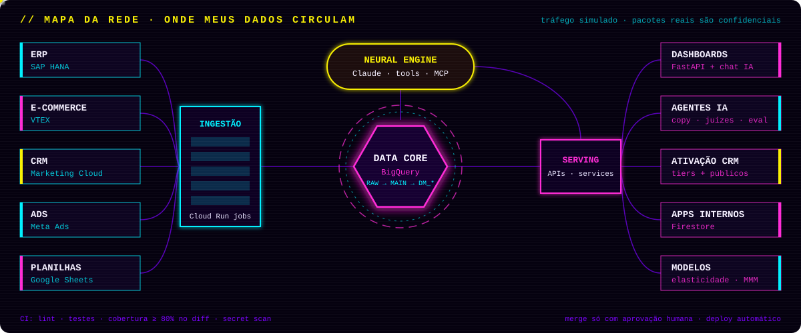

<p align="center">
  
</p>

<p align="center">
  
</p>

<p align="center">
  
  
</p>

---

<p align="center">
  
</p>

<p align="center">
  
</p>


---

## 🌐 `> netmap --live`

<p align="center">
  
</p>

---

## ⚡ `> contratos --ativos`

<p align="center">
  
</p>

<details>
<summary><b>🧊 ICE quebrado — logs de invasão</b> <i>(clica pra abrir)</i></summary>
<br/>

```diff
- [BREACH] estoque sumia quando um pedido voltava de etapa
+ [PATCH ] estorno transacional em todo caminho de volta + reconciliação retroativa

- [BREACH] schema inferido pelo dataframe derrubava o DELETE da carga seguinte
+ [PATCH ] schema explícito em toda escrita + vigiar a 2ª execução, não só a 1ª

- [BREACH] token começou a ser rejeitado no meio de um deploy "em fases"
+ [PATCH ] a lib validava o claim sozinha: emitir e exigir no mesmo passo, com audience explícita

- [BREACH] trava anti-clique-duplo resetava a cada render
+ [PATCH ] estado de trava no nível do módulo, testado com clique forçado

- [BREACH] 409 fantasma: NULL ≠ FALSE dentro de uma trava atômica
+ [PATCH ] COALESCE na condição e teste cobrindo registro legado

- [BREACH] cold start acordando o app toda manhã
+ [PATCH ] telemetria primeiro, instância mínima depois — custo medido nos dois lados
```

</details>

---

## 🧬 `> implantes --list`

<p align="center">
  
  <br/>
  
</p>

<p align="center">
  
  
  
  
  
  
  
  
  
  
  
  
  
  
</p>

<details>
<summary><b>🔩 Especificações do cyberdeck</b></summary>
<br/>

| Slot | Implante | Função |
|---|---|---|
| 🧠 Córtex | **Python · SQL** | a linguagem nativa do sistema nervoso |
| 💾 Memória | **BigQuery · Firestore** | camadas raw → main → data marts, e NoSQL pros apps |
| ⚙️ Músculo | **Cloud Run · Scheduler · Docker** | jobs agendados e services que dormem quando ninguém olha |
| 👁️ Sensores | **SAP · VTEX · CRM · Ads · Sheets** | tudo que entra, entra por um conector testado |
| 🤖 Co-piloto | **Claude · MCP · agentes** | parsing, julgamento, geração e chat em cima dos dados |
| 🛡️ Firewall | **CI + quality gate** | lint, secret scan e cobertura ≥ 80% das linhas alteradas |

</details>

---

## 🔐 `> acesso --restrito`

<p align="center">
  
</p>

<p align="center">
  
</p>
